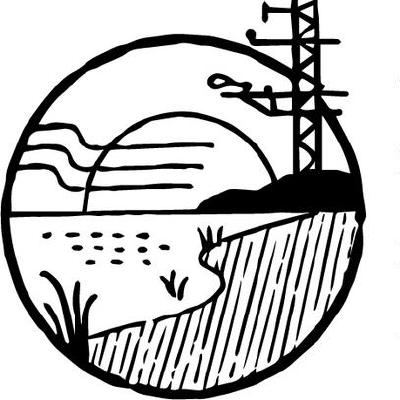

```{=html}
<section class="hero">
  <div class="hero-brand">
    
    
  </div>
  <div class="eyebrow">Malone Disturbance Ecology Lab · Yale School of the Environment</div>
  <h1>Open Data &amp; Tools</h1>
  <p class="lead">Explore ecosystem change, carbon dynamics, and environmental disturbances across spatial and temporal scales.</p>
  <form class="hero-search" action="products.html" method="get" role="search">
    <input type="search" name="search" placeholder="Search datasets, variables, regions…" aria-label="Search data products">
    <button type="submit">Search</button>
  </form>
  <div class="chips">
    <a href="products.html">All products</a>
    <a href="products.html#category=Geospatial">Geospatial</a>
    <a href="products.html#category=Flux%20data">Flux data</a>
    <a href="software.html">R packages</a>
    <a href="publications.html">Publications</a>
    <a href="apps.html">Apps</a>
  </div>
</section>
```

## Product collections



## Featured data products

::: {#featured}
:::

[Browse all data products →](products.qmd){.btn .btn-primary}

## How this hub works

Every product on this site is archived in [DataONE](https://search.dataone.org/portals/3107251), which stays the permanent, citable record (DOI, version, license). This hub is the front door: it explains what each product is, where and when it applies, how to load it, and how to cite it. Pages are rebuilt automatically from the DataONE metadata, so the two never drift apart.
